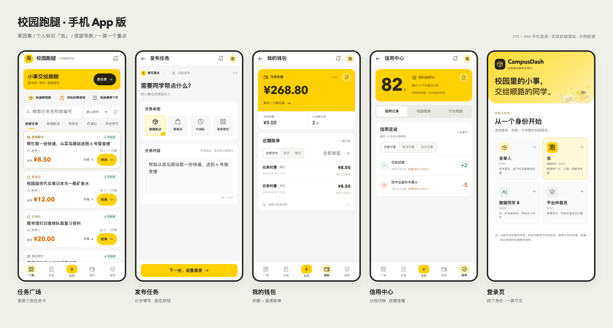

# CampusDash 校园跑腿抢单市场

高级分层架构的并发与一致性工程样本：发单人悬赏（资金托管）→ N 人同时抢、恰好一个成功
→ 限时未确认自动流转 → 送达确认后结算给跑腿与平台。业务链路短，但每个环节都踩在硬骨头上：
抢单正确性可验证（超卖就是错）、资金正确性可验证（借贷不平就是错）。



## 项目结构

```
campus-dash/
├── campus-dash-backend/       # 后端项目（Java/Python + Spring Boot + Maven）
│   ├── dash-domain/           # 领域层：业务规则、领域模型
│   ├── dash-application/      # 应用层：发布/抢单/确认/流转/结算/退款/仲裁/对账编排
│   ├── dash-infrastructure/   # 基础设施层：数据库、缓存、MQ、ShardingSphere 规则、Sentinel
│   ├── dash-presentation/     # 接口层：REST API
│   ├── dash-worker/           # 后台任务：超时流转/自动结算/资金事件消费者、兜底扫描、对账 job
│   ├── dash-bootstrap/        # 应用装配 + 54 个集成测试
│   ├── dash-bench/            # 压测工具
│   ├── dash-shared/           # ErrorCode / Money（long 存分）/ Result / 雪花 ID
│   ├── docker/                # Docker Compose 编排
│   └── docs/                  # 设计文档、分期决策、踩坑记录
└── campus-dash-frontend/      # 前端项目（React + TypeScript + Vite）
    ├── src/                   # 源代码
    │   ├── components/        # 通用组件
    │   └── pages/             # 页面
    └── package.json           # npm 依赖
```

## 环境要求

- JDK 21+（推荐 JDK 21）
- Maven 3.9+（[安装指南](https://maven.apache.org/install.html)）
  - macOS: `brew install maven`
  - Ubuntu/Debian: `sudo apt install maven`
  - Windows: 下载 [binary](https://maven.apache.org/download.cgi) 并配置环境变量
- Docker（MySQL 8 + Redis 7 + RocketMQ 5.3.1，由 docker-compose 管理）
- Node 18+（仅前端需要）

## 快速开始

### 0. 一条命令（推荐）

在仓库根目录：

```powershell
.\start.ps1                # 全量：主项目前后端 + agent，构建后重启
.\start.ps1 -Build api     # 只改了主项目后端（Maven 打包）
.\start.ps1 -Build web     # 只改了主项目前端（tsc + vite build）
.\start.ps1 -Build agent   # 只改了 agent 后端（提示词 / 抽取器 / 会话逻辑）
.\start.ps1 -Build agentui # 只改了 agent 聊天界面（agent/agent-frontend/src）
.\start.ps1 -Build none    # 不构建，只重启
.\start.ps1 -Status        # 看容器状态与健康检查
.\start.ps1 -Logs          # 跟随 app / worker / web / agent 日志
.\start.ps1 -Down          # 停止（保留数据库）
```

首次运行前需要 Docker Desktop 已启动（或加 `-StartDocker` 让脚本自己拉起）。
脚本会把访问地址打印出来：**http://localhost:8088**。

#### `-Build` 参数一览

| 取值 | 构建内容 | 什么时候用 |
| --- | --- | --- |
| `all`（默认） | 主项目后端 + 主项目前端 + agent 镜像 | 不确定改了哪里，或一次改了好几处 |
| `api` | `dash-bootstrap` / `dash-worker` fat jar | 只改 Java 代码 |
| `web` | `campus-dash-frontend`（tsc + vite build） | 只改主项目页面 |
| `agent` | `dash-agent:local` 镜像（`agent/app`） | 只改 agent 的提示词、抽取器、会话逻辑 |
| `agentui` | 重建 web（`agent/agent-frontend` 经 `@agent` 别名编进主前端） | 只改 agent 聊天窗口的界面 |
| `none` | 不构建 | 只想重启容器，或改了 compose / 环境变量 |

> `agentui` 本质仍是重建 web 镜像：agent 的 React 界面不是独立应用，
> 它通过 Vite 别名 `@agent` → `../agent/agent-frontend/src` 打进主前端产物。
> 分成两个参数是为了让你一眼看出"我这次改的是 agent 的哪一半"。

脚本会按顺序做四件事，任何一步失败都会打印日志尾部并以非 0 退出：

1. 按 `-Build` 跑 Maven / npm 构建；
2. `docker compose build` 重建对应镜像；
3. `up -d app worker agent web`（agent 在 web 之前，避免 nginx 先启动拿不到 agent 主机名）；
4. 等 `/api/health` 与 `/agent/health` 都通过，再打印容器状态与访问地址。

下面是手动分步的做法，便于理解每一步在做什么。

**推荐用AI（启动提示词如下）**：
> 在编程助手中打开该工程目录，可以使用以下提示：帮我启动这个项目。先阅读 README 和现有配置，检查环境与端口。安装缺失依赖，启动前后端，检查健康接口并完成一次页面请求。缺少配置时说明需要配置哪些字段。最后告诉我访问地址和停止服务的方法。


### 1. 启动后端

```bash
cd campus-dash-backend

# 起中间件并初始化（表、topic、消费组）
cd docker && docker compose up -d && sleep 15 && ./init-mq.sh && cd ..

# 跑测试（当前累计 93 个测试；中间件没起时集成测试 skip 而不是 fail）
mvn clean test

# 启动应用（默认 8080，后门关闭，只认 Bearer token）
mvn -pl dash-bootstrap spring-boot:run

# 启动 worker（超时流转 / 自动结算 / 资金事件消费 / 消息重发，另一个终端）
mvn install -DskipTests
java -jar dash-worker/target/dash-worker-1.0.0-SNAPSHOT.jar
```

### 1.1 或者：一条命令起全栈（nginx + 应用 + worker + 中间件）

已经构建过前端产物后（`mvn -pl dash-bootstrap,dash-worker -am package -DskipTests` + `npm run build`）：

```bash
cd campus-dash-backend/docker
docker compose -f docker-compose.yaml -f docker-compose.full.yaml up -d --build
```

访问 **http://localhost:8088**：nginx 托管前端静态文件，并把 `/api/**` 与 `/ws` 反代到应用容器，
前端与 API 同源（不需要 CORS，也不需要 vite 代理）。详见
[docker/README-full-stack.md](campus-dash-backend/docker/README-full-stack.md)。

这套 compose 也会拉起 **agent 服务**（Python / FastAPI，容器内 8000，对外经 nginx 的 `/agent/` 前缀，
转发时剥掉前缀）：

| 路径 | 作用 |
| --- | --- |
| `/agent/health` | 健康检查，返回 `{"status":"ok"}` |
| `/agent/sessions` | 创建 / 列出 / 删除会话 |
| `/agent/chat` | 一轮对话（追问 / 抽取 / 意图识别） |
| `/agent/publish` | 把确认后的草稿转发给主项目发单接口 |

> nginx 对 `agent` 用的是 `resolver 127.0.0.11` + 变量的写法：agent 容器重建后 IP 会变，
> 直接用 `proxy_pass http://agent:8000/` 只在启动时解析一次，之后会一直 502。

### 2. 启动前端

```bash
cd campus-dash-frontend

# 安装依赖
npm install

# 启动开发服务器（5173，vite 代理 /api -> 8080）
npm run dev
```

访问 http://localhost:5173，选择演示身份登录：
- 发单人 1001
- 跑腿 2001、2002
- 仲裁员 9001

### API 快速体验（不走前端）

```bash
TOKEN=$(curl -s -X POST localhost:8080/api/auth/login \
  -H 'Content-Type: application/json' -d '{"userId":1001}' \
  | python3 -c "import sys,json;print(json.load(sys.stdin)['data']['token'])")

# 发布（资金同步托管）、抢单、全生命周期操作
curl -s -X POST localhost:8080/api/errands -H "Authorization: Bearer $TOKEN" \
  -H 'Content-Type: application/json' \
  -d '{"title":"帮我带份饭","rewardCents":1500,"slotTotal":1}'
# 详情响应含 availableActions：前端按钮完全由它驱动，不实现第二份状态机
```

### 压测与数据治理

```bash
# S1 尖峰：2000 并发抢 1 名额（应用层与数据库侧双验证）
# S4 资金：500 任务并发结算 / 200 并发结算同一任务（SettleConcurrencyIT）
cd campus-dash-backend && mvn test -Dtest=SettleConcurrencyIT

# 按轮次校验与清理（数据默认保留最近 10 轮，便于改动前后对比）
RUN_ID=<runId> bash bench/scripts/verify_run.sql   # 抢单侧五条不变式
bash bench/scripts/verify_fund.sql                  # 资金侧五条不变式
bash bench/scripts/cleanup.sh --keep-last 10
```

## 核心机制

### 后端架构

- **DDD 洋葱四层（很简单且很有用）**：dash-domain（零框架依赖）→ dash-application → dash-infrastructure → dash-presentation
- **ArchUnit 强制**：领域层不许碰框架、端口定义在领域层、模型不依赖端口

### 抢单五层防护

Sentinel 热点参数限流 → 资格前置（信用分 + 在途任务数）→ Redis Lua 原子判定（名额扣减+幂等）→ MySQL CAS → 双唯一索引兜底。

**对照实验证明**：拆掉任一层都能压出超卖（名额 -499 / 158 人抢中同一名额）。

### 分片策略

- 任务链路表按 `campus_id` 分片
- 账户/信用表按 `user_id` 分片
- ShardingSphere 规则工厂与 class-based 取模算法已纳入测试

### 超时流转 / 自动结算

主通道（MQ 定时消息）追实时、兜底扫描追不丢，靠幂等三件套（version CAS + round 轮次 + msg_key 唯一索引）保证双通道重复执行无副作用。

### 两种消息一致性机制

按"是否需要延迟"分工：
- **要延迟**（确认超时、自动结算）：本地消息表 + 定时消息
- **不要延迟**（资金事件通知）：事务消息（半消息 + 回查）

### 资金三道幂等闸门

escrow 状态 CAS + errand 状态 CAS + wallet_ledger.biz_no 唯一索引。

三层对账（L1 借贷平衡 / L2 快照一致 / L3 托管闭环）兜底。

### availableActions

状态机只存在于领域层，前端操作按钮由后端计算的动作集合驱动，前端零状态机。

### long→string 序列化

雪花 ID 超过 JS 安全整数（2^53），Jackson 全局转 string。

### 前端特性

- **React 18** + TypeScript + Vite 快速构建
- **WebSocket** 实时推送
- **7 个页面**：任务广场、发布任务、我的任务、钱包、信用分、消息、详情

## 学习路径

建议按以下顺序学习：

1. **后端架构**：阅读 `campus-dash-backend/docs/架构设计与技术选型.md`
2. **领域模型**：从 `campus-dash-backend/dash-domain` 开始，理解业务规则
3. **并发控制**：重点看抢单链路（Redis Lua + DB CAS）
4. **资金链路**：理解复式记账和对账机制
5. **前端交互**：从 `campus-dash-frontend/src/pages/Square.tsx` 开始

## 文档

- [后端架构设计](campus-dash-backend/docs/架构设计与技术选型.md)
- [设计演进记录](campus-dash-backend/docs/设计演进记录.md)（八期进度 + 18 条踩坑）
- [压测方案](campus-dash-backend/docs/压测方案与容量评估.md)
- 面试题库：92 题 + 指标深挖，详见在线文档

## 技术栈

### 后端
- Java 21
- Spring Boot 3.5.8
- MySQL 8.0
- Redis 7.4
- RocketMQ 5.3.1
- ShardingSphere 5.5.2（分库分表）
- Sentinel 1.8.8（热点限流）

### 前端
- React 18
- TypeScript
- Vite 5
- WebSocket API

## 项目规模

- **后端代码**：8 个 Maven 模块，93 个测试用例
- **前端代码**：7 个页面，3 个通用组件
- **教程**：12 篇 32 章完整教程，覆盖架构设计到压测调优
- **面试题库**：92 题 + 8 道指标深挖

## 已知边界（诚实清单）

- 单机默认稳定线到 400 并发：S2 60s 档位约 6455 QPS、P99 151ms；默认 800 并发有 146 个 IOException，调参后 800 并发 0 错误但 P99 472ms
- 流转准时率 P99 仍为 `[待补充]`：需要自然到期时间轴重测
- 压测环境无隔离（应用/中间件/发压端同机），数字仅作同机基线
- 前端"模拟 N 人同时抢"用临时身份演示，临时身份无钱包账户，别用它走完生命周期
- ES/Canal 已在 P4 摘除（校园场景不需要），一致性兜底是校验 job 而非 binlog 秒级纠正
- 鉴权已支持 Session/JWT 双实现与 refresh token；测试配置保留 `X-User-Id` 后门仅供压测


## 当前进度：P8（教程正文 + 面试题库）已完成

| 期  | 内容                                                                                                        | 状态 |
| --- | ----------------------------------------------------------------------------------------------------------- | ---- |
| P1  | 抢单最小闭环（Redis Lua + DB CAS 双保险，S1 尖峰 2000 并发零超卖）                                          | ✅    |
| P2  | 超时流转（RocketMQ 定时消息 + 兜底扫描）、本地消息表、数据治理（run_id 分轮）                               | ✅    |
| P3  | 资金完整链路（结算/退款/仲裁/自动结算/三层对账）、事务消息、S4 压测、事务陷阱测试                           | ✅    |
| P4  | 12 个 API 端点 + 简易登录 + availableActions + React 前端；ES/Canal 决策摘除                                | ✅    |
| P5  | 缓存一致性（Cache Aside + Redisson 布隆 + 逻辑过期 + 校验 job）、信用分体系、WebSocket 实时推送、JWT 双实现 | ✅    |
| P6  | 分片键贯通、ShardingSphere 规则与 class-based 算法、游标分页、refresh token、信用分校准                     | ✅    |
| P7  | S2 阶梯压测、800 并发调参复测、Sentinel 热点参数限流、P6/P7 完成报告                                        | ✅    |
| P8  | 12 篇 32 章教程正文、教程导读校准、面试题库与指标深挖                                                       | ✅    |

期次进度、功能清单、指标现状见 [campus-dash-backend/docs/设计演进记录.md](campus-dash-backend/docs/设计演进记录.md) 的「进度快照」；
决策与踩坑的完整记录同文件（八期进度 + 18 条踩坑档案）。

---

**这是一个教学项目**，旨在演示高并发场景下的后端工程实践。所有设计决策都有详细的文档和压测数据支撑。
