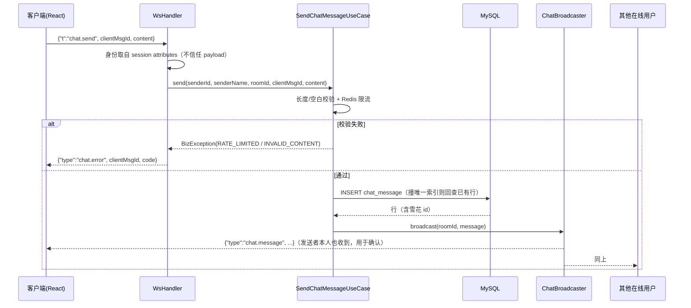

# 广场聊天室（侧边栏公共聊天）技术方案

## 0. 结论摘要

| 问题 | 结论 |
| --- | --- |
| 能不能做 | 能。改动面 = 1 张表 + 1 组端口/用例 + `WsHandler` 一个入站分支 + 1 个前端组件 |
| 通道 | **复用现有 `/ws` 单连接**，协议从"只下行"扩成"上下行"；不新开 `/ws/chat` |
| 实时推送 | 落库成功后再广播（先写后推），广播失败只记日志，DB 是事实源 |
| 历史存储 | **MySQL 单表 `chat_message`**，雪花 ID 作游标；不引入 Mongo / ES / Redis Stream |
| 读取 | 首屏拉最近 50 条 → 上翻 `beforeId` → 重连 `afterId` 补洞 |
| 广播范围 | 一期单实例内存注册表；多实例用 `ChatBroadcaster` 端口 + 配置切 Redis Pub/Sub |
| 新增中间件 | 无。Redis 只用于限流和（可选的）最近 100 条热缓存 |

一句话：**这是一次"在既有实时通道上加一条业务语义"的改造，不是引入一套 IM 基础设施。**

### 关于"左侧边栏下半部分"的定位

本文按"全局左侧导航栏"理解：`.sidebar` 固定左侧、宽 228px、`flex-direction: column`、`overflow-y: auto`，
下半部分指导航列表之下、钱包/账号之上的那块——目前被 `.sidebar-guide`（"顺路，帮个小忙"文案块，约 200px）占着。

如果你指的是广场页右侧的 `.market-aside`，组件本身不用改，只改挂载位置一行。

## 1. 现状盘点

### 1.1 已经能复用的

| 能力 | 位置 | 对聊天的价值 |
| --- | --- | --- |
| WS 握手 token 鉴权 | `WsAuthHandshakeInterceptor`（`?token=` → `AuthPort.resolve`） | 不用重做鉴权，userId 直接进 session attributes |
| 在线连接表 | `WsSessionRegistry`：`String userId → Set<WebSocketSession>` | 广播的底座；多端登录天然支持 |
| 前端连接管理 | `ws.ts`：握手、心跳 30s、退避重连 1s→8s、`subscribeWs` 分发 | 直接复用生命周期，只加"发送"和"补洞" |
| 游标分页约定 | `CursorPage<T>` + `CursorPaginationIT` | 历史消息沿用同一个分页语义，不发明第二套 |
| 定时任务 | `dash-worker` 里一堆 `@Scheduled` + `local_message` | 归档 job 有现成落点 |
| 用户展示信息 | `user` 表：`username`、`avatar_url`、`campus_id` | 发送人名字来源 |
| 前端布局 | `.sidebar` 已 `overflow-y: auto`，`.sidebar-bottom { margin-top: auto }` | 聊天面板插在中间即可 |

### 1.2 缺口

| 缺口 | 说明 | 影响 |
| --- | --- | --- |
| WS 是单向的 | `WsHandler.handleTextMessage` 只认 `ping`，注释明确"其他客户端消息一律忽略" | 必须改协议语义，并保留旧客户端 `ping` 兼容 |
| 没有广播原语 | `RealtimePushService` 只会按 userId 推；注册表没有"发给所有人" | 加 `broadcast`，同时处理慢消费者 |
| 前端不能发 | `ws.ts` 只有 `subscribeWs`，没有 send | 加 `sendWs` + 队列/降级 |
| 没有任何消息表 | `notification` 是"站内通知"，按 `user_id` 一人一条，不是聊天 | 新建 `chat_message`，不要复用 `notification` |
| 单进程广播 | 注册表是内存，多实例互相看不见 | 一期接受（见 2.3），用端口隔离好 |

### 1.3 不要复用的东西（关键判断）

- **不要复用 `notification`**：它是"一个事件 × 一个接收人 × 不可变"，聊天是"一个房间 × N 个接收人 × 流式"，索引方向（`user_id, created_at`）和语义都不对。
- **不要复用 `local_message`**：那是"要可靠投递到 MQ 的消息登记表"，聊天不需要 MQ 中继，落库即达。
- **不要放进 `errand` 的分片规则**：现有分片按 `campus_id` 切任务链路表，聊天是独立追加型写入，硬塞进 errand 分片只会让两边的热点互相拖累。`campus_id` 列先留着，将来要分片再按它切。

## 2. 技术选型

### 2.1 传输：WebSocket vs 其它

| 方案 | 双向 | 实时性 | 与现有栈的关系 | 结论 |
| --- | --- | --- | --- | --- |
| **WebSocket（复用 `/ws`）** | ✅ | 毫秒级 | 已有握手鉴权、心跳、重连、vite 代理 | **采用** |
| WebSocket（新开 `/ws/chat`） | ✅ | 毫秒级 | 多一条连接、多一套心跳/重连/鉴权 | 暂不采用，见下 |
| SSE + HTTP POST | 半（下行推送、上行另发） | 毫秒级 | 要新写一套 EventSource 生命周期 | 备选；但浏览器 HTTP/1.1 同域 6 连接限制、且项目已有 WS |
| MQTT | ✅ | 毫秒级 | 要引入 broker + 客户端库 | 过度设计 |
| 长轮询 | 半 | 秒级 | 实现简单、服务端线程占用高 | 只作为 WS 不可用时的兜底 |

**为什么复用 `/ws` 而不是新开**：连接数是成本，不是免费的。复用后心跳、重连、鉴权、Token 刷新后重连全部沿用现成逻辑；
聊天在这个项目里是"广场大厅"级别的低频场景（见 3.5 容量估算），没到需要独立通道扩容的地步。

**什么时候该拆**：出现以下任一情况再拆 `/ws/chat`——
1. 聊天需要独立的线程池/背压策略，不能被任务状态推送的抖动影响；
2. 要上私聊（大量会话、每用户订阅不同房间）；
3. 聊天连接数远大于业务推送连接数，需要单独扩容。

### 2.2 协议：JSON 帧，双向，带客户端幂等 ID

现有协议是 `{type, payload}` 单向。扩成双向时**保持同一外壳**，只加客户端→服务端的 `t` 字段，避免两套格式。

客户端 → 服务端：

```json
{ "t": "chat.send", "clientMsgId": "9f3c1a2e-1", "content": "有人一起去二食堂吗" }
```

服务端 → 客户端（广播帧，发送者本人也会收到）：

```json
{
  "type": "chat.message",
  "payload": {
    "id": "236054218518040576",
    "roomId": "square",
    "senderId": "01b8a239-...",
    "senderName": "小林",
    "content": "有人一起去二食堂吗",
    "createdAt": "2026-10-27T23:20:11.123+08:00",
    "clientMsgId": "9f3c1a2e-1"
  }
}
```

错误帧（只回给发送者）：

```json
{ "type": "chat.error", "payload": { "clientMsgId": "9f3c1a2e-1", "code": "RATE_LIMITED", "message": "发得太快了，歇一秒" } }
```

设计要点：

1. **发送人身份只认握手会话**（`session.getAttributes().get("wsUserId")`），payload 里不接受 `senderId`。客户端传什么都可以忽略。
2. **`clientMsgId` 是幂等键**：客户端生成 UUID，断线重发带同一个 ID，靠 `uk_client_msg` 唯一索引兜住重复。不用服务端回执协议——广播帧里回显 `clientMsgId` 就是回执，少一次往返、少一种状态。
3. **乐观渲染 + 5s 超时**：本地先插一条 `pending` 气泡；收到回显帧按 `clientMsgId` 替换成服务端 id（状态转 `sent`）；5s 没回显标红可重发（同一个 `clientMsgId`）。
4. **`ping`/`pong` 保持原样**，旧客户端不受影响；`chat.send` 走新的入站分支。
5. 单帧文本上限：Tomcat WS 默认 8KB，聊天正文限 500 码点，远低于上限；仍建议显式配置 `setMaxTextMessageBufferSize(8192)`，收到超长帧直接断开而不是解析。

### 2.3 广播与多实例

一期（当前部署：单应用实例）：

```
WsSessionRegistry 加 broadcast(json)
  → 遍历所有 userId 的 session 集合
  → 每个 session 用 ConcurrentWebSocketSessionDecorator 发送
```

**必须做的一件事：慢消费者隔离。** `WebSocketSession.sendMessage` 是阻塞的，一个网络差的客户端会把广播线程拖住，
后面所有人都跟着卡。做法是在 `afterConnectionEstablished` 里用
`new ConcurrentWebSocketSessionDecorator(session, 5000, 512 * 1024)` 包一层再入注册表：
超过 5s 或积压 512KB 就直接断开该连接，由它的重连逻辑去补洞。
`WsSessionRegistry` 的 `remove` 改为按 sessionId 匹配（装饰器 `getId()` 是透传的）。

二期（要起第二个应用实例时）：加一个端口 `ChatBroadcaster`，两个实现：

| 实现 | 触发条件 | 行为 |
| --- | --- | --- |
| `LocalChatBroadcaster` | 默认 | 只遍历本进程注册表 |
| `RedisChatBroadcaster` | `dash.chat.broadcast=redis` | `PUBLISH chat:room:{roomId}` + 订阅回调里再写本地注册表 |

切换只动基础设施层一个类，业务代码不变。**要诚实写进文档**：单实例限制下，
"实例 A 的用户发给实例 B 的用户"是收不到的——这和现有 `RealtimeNotifier` 跨进程推不到 worker 是同一类问题，
不要假装它不存在。

### 2.4 存储选型对比

| 方案 | 写入成本 | 按房间+时间读 | 保留/归档 | 运维成本 | 结论 |
| --- | --- | --- | --- | --- | --- |
| **MySQL 单表（InnoDB）** | 1 次 insert | 走 `(room_id, id)` 索引，毫秒级 | 归档表 + 批量删 | 已有，零新增 | **采用** |
| Redis Stream | `XADD` O(1) | `XRANGE` 很快 | `MAXLEN` 一裁剪历史就没了；AOF/RDB 仍有丢失窗口 | 已有 Redis，但要做持久化承诺 | 只当热缓存，不当事实源 |
| Redis List | `LPUSH` O(1) | 只能取最近 N 条 | 同上 | 低 | 同上 |
| MongoDB | 单文档写 | 天然适合聊天文档 | 好 | **新增一种数据库** | 否，与 P4 摘 ES 的运维取向冲突 |
| ES / ClickHouse | 批量写 | 搜索强 | 好 | 重 | 否，校园量级用不上 |
| RocketMQ 当存储 | 生产快 | 不可查询 | 按天过期 | 已有 MQ | 否，MQ 不是数据库 |
| 第三方 IM SDK | 无 | 厂商提供 | 厂商提供 | 外部依赖 + 费用 | 否，本项目就是要讲清这套机制 |

**结论**：MySQL 是事实源，Redis 只做限流（和可选的热缓存）。
理由不是"MySQL 快"，而是**只有它同时满足"可查询、可事务、可归档、零新增运维"**。

## 3. 历史消息保存方案（核心）

### 3.1 表结构

```sql
-- 广场聊天消息：append-only。除撤回改 status 外，行不更新。
-- 不放 errand 分片规则：写模式和热度都与任务链路不同。
CREATE TABLE IF NOT EXISTS chat_message (
  id            BIGINT       NOT NULL COMMENT '雪花 ID，时间有序，兼作游标',
  room_id       VARCHAR(32)  NOT NULL COMMENT '房间：一期固定 square，将来 square:{campusId} / dm:{小id}:{大id}',
  campus_id     BIGINT       NOT NULL DEFAULT 1 COMMENT '校区，分片键预留',
  sender_id     VARCHAR(36)  NOT NULL COMMENT '发送人 user_id（UUID / 001）',
  sender_name   VARCHAR(32)  NOT NULL COMMENT '发送时的显示名，冗余存储',
  content       VARCHAR(500) NOT NULL COMMENT '正文，最多 500 码点',
  msg_type      VARCHAR(16)  NOT NULL DEFAULT 'TEXT' COMMENT 'TEXT 本期唯一，预留 IMAGE/SYSTEM',
  client_msg_id VARCHAR(64)  NULL     COMMENT '客户端幂等键，HTTP 调用可为空',
  status        TINYINT      NOT NULL DEFAULT 1 COMMENT '1 正常 / 0 撤回 / 2 被屏蔽',
  created_at    DATETIME(3)  NOT NULL DEFAULT CURRENT_TIMESTAMP(3),
  PRIMARY KEY (id),
  -- 幂等：同一发送人的同一 clientMsgId 只落一行；NULL 不参与唯一约束（MySQL 允许多个 NULL）
  UNIQUE KEY uk_client_msg (sender_id, client_msg_id),
  -- 主查询索引：按房间取一段 id 区间，天然覆盖 order by id
  KEY idx_room_id (room_id, id),
  -- 归档/删除 job 用
  KEY idx_created (created_at)
) ENGINE=InnoDB DEFAULT CHARSET=utf8mb4 COMMENT='广场聊天消息';
```

配套归档表（同结构、无业务索引）：

```sql
CREATE TABLE IF NOT EXISTS chat_message_archive LIKE chat_message;
```

### 3.2 每个设计点为什么这样定

| 设计点 | 选择 | 理由 |
| --- | --- | --- |
| 主键 | 雪花 ID（`SnowflakeIdGenerator`，已有） | 全局唯一、时间有序，**直接当游标用**；多实例也不会撞 |
| 游标 | `id` 而非 `created_at` | `DATETIME(3)` 同毫秒会撞，翻页要再加 tiebreaker；id 单调递增，`WHERE id < ?` 一行搞定 |
| 不用 offset 分页 | — | 聊天是"不断有新行插入"的流，`LIMIT ? OFFSET ?` 会重复/漏行，翻到后面还越来越慢 |
| `sender_name` 冗余 | 存快照 | 改昵称不该回改历史消息；也避免每次查询 join `user` |
| `room_id` 提前留 | 一期只有 `square` | 加私聊/分校区的改动只在取值，不动表结构 |
| `content` 用 VARCHAR(500) | 不是 TEXT | 有上限才好做长度校验和行宽估算；500 码点够一条广场消息 |
| `status` | 软删除 | 撤回/被屏蔽要留证据，物理删了没法审计 |
| 不加 `updated_at` | — | append-only，加了也永远是插入时间，徒增写放大 |

### 3.3 三种读取场景

统一返回**升序**（旧→新），前端直接 append，不用自己 reverse。

**场景 A：打开面板，拉最近 N 条**

```sql
SELECT id, room_id, sender_id, sender_name, content, msg_type, status, created_at
FROM chat_message
WHERE room_id = ? AND status = 1
ORDER BY id DESC
LIMIT ?;          -- 默认 50，上限 100
```

结果在服务端反转成升序返回，`nextCursor` = 本页最小 id（用于继续上翻）。

**场景 B：向上翻历史**

```sql
... WHERE room_id = ? AND status = 1 AND id < ? ORDER BY id DESC LIMIT ?;
```

`nextCursor` 为 null 表示到顶（最早一条）。

**场景 C：断线补洞（最容易被漏掉的一条）**

```sql
... WHERE room_id = ? AND status = 1 AND id > ? ORDER BY id ASC LIMIT ?;
```

重连后前端拿内存里最大的 id 调 `afterId`，把断线期间的消息补回来。
**没有这一步，任何一次网络抖动都会静默丢消息**——而且是"看起来正常、实际少了几条"的丢法，最难排查。
如果返回条数等于 limit，说明洞还没补完，继续用新的最大 id 再拉一次，直到不满一页。

对应接口（读写分开，HTTP 是**发送的规范入口**，WS 只是快路径）：

```
GET  /api/chat/messages?room=square&limit=50
GET  /api/chat/messages?room=square&beforeId=123&limit=50
GET  /api/chat/messages?room=square&afterId=456&limit=200
POST /api/chat/messages            { clientMsgId, content }
     → { id, senderId, senderName, content, createdAt, clientMsgId }
```

> 为什么发送要有 HTTP 入口：集成测试不用起 WS 客户端；WS 不可用时前端能降级；入站 WS 和 REST 调**同一个用例**，不会出现两套校验。
> 两条路径都做"落库 → 广播"，所以对方收到的实时性完全一样。

### 3.4 幂等与重发

- 客户端每次发送生成 `clientMsgId`（`crypto.randomUUID()`），重发复用同一个。
- 服务端 `INSERT` 撞 `uk_client_msg` → 捕获 `DuplicateKeyException` → `SELECT` 回那一行当成功返回（不报错）。
  用户看到的是"发出去了"，实际库里只有一条。
- 为什么不用 Redis `SETNX` 做幂等：多一次网络往返，还要设过期时间；唯一索引是数据库免费送的、且永久有效。

### 3.5 容量估算与保留策略

按校园场景估：

| 指标 | 一期（1 校区） | 压力场景（全校 2 万人） |
| --- | --- | --- |
| 在线峰值 | ~300 | ~2000 |
| 人均发送 | 2 条/分钟 | 3 条/分钟 |
| 峰值写入 | ~10 msg/s | ~100 msg/s |
| 单行大小（含索引） | ~350 B | ~350 B |
| 日增 | ~2 万条 / ~7 MB | ~860 万条 / ~3 GB |
| 90 天 | ~180 万条 / ~600 MB | ~7.7 亿条 / ~270 GB |

一期结论：**单表 600MB、百万行级，MySQL 毫无压力，不需要分区、不需要分表。**
真正的成本不在存储，在广播：`广播次数 = 在线数 × 消息数`。300 在线 × 10 msg/s = 3000 次 send/s，可接受；
2000 在线 × 100 msg/s = 20 万次 send/s，这时必须按校区拆房间 + Redis Pub/Sub + 批量合并，不是换数据库能解决的。

保留策略：

- 热数据保留 **90 天**（`dash.chat.retention-days`），够用户回看，也够运营追溯。
- worker 每天 04:00 跑归档 job：先把 `created_at < cutoff` 的批次 `INSERT INTO chat_message_archive`，
  再 `DELETE FROM chat_message WHERE created_at < ? ORDER BY id LIMIT 1000` 循环到 0 行。
  **不要一条 `DELETE` 删几百万行**：长事务、锁等待、binlog 暴涨、主从延迟，四连击。
- 为什么不用分区表按天 `DROP PARTITION`（更优雅，但这里有个坑）：
  MySQL 要求分区表的所有唯一索引都包含分区键，`uk_client_msg (sender_id, client_msg_id)` 会被迫变成
  `(sender_id, client_msg_id, created_at)`，同一条消息跨秒重发就不再幂等。
  一期用归档表；真需要分区时，幂等改由 Redis 承担，这是一次明确的取舍，不是随手决定的。

### 3.6 要不要给历史加 Redis 缓存

**一期不加。** 理由：

- 读放大很低：每个用户打开面板拉一次 50 条，之后只有上翻；
- 查询走 `(room_id, id)` 覆盖索引，单次 5ms 以内；
- 加了缓存就要回答一致性（新消息要不要写缓存）、淘汰、冷启动三个问题，而聊天是**只追加**的，
  这三点本来都不存在，别自己造出来。

量到了再加，方案很小：

```
key:    chat:{roomId}:recent          LIST，存最近 100 条 JSON（新→旧）
写:     LPUSH + LTRIM 0 99（在落库之后的广播路径里顺手做）
读:     LRANGE 0 49；miss 则回源 MySQL 后重建
失效:   不需要——只追加，天然单调
```

### 3.7 内容安全与合规

| 风险 | 处理 |
| --- | --- |
| XSS | React 默认转义文本节点；**禁止** `dangerouslySetInnerHTML`。服务端不存储 HTML |
| 超长/空消息 | 校验 `1 ≤ codePointCount ≤ 500`，trim 后为空直接拒；控制字符过滤（保留 `\n`，限 5 行） |
| 刷屏 | Redis 固定窗口限流：`INCR chat:rl:{userId}:{epochSec}` + `EXPIRE 2`，超过 3 条/秒返回 `RATE_LIMITED`；多实例天然一致 |
| 敏感词 | 一期可先不做；要做就用本地 DFA 词表（不引三方服务），命中写 `status=2` 并对发送者提示 |
| 禁言/封号 | 二期：`chat_mute(user_id, until, reason)`，发送前查一次（Redis 缓存 60s）；管理员权限走现有 `role=Admin` |
| 举报/撤回 | 撤回改 `status=0`（保留原文供审计）；举报二期 |
| Token 泄露 | 现有实现把 token 放 URL query（浏览器 WS 不能设 header），生产应换成一次性 ticket + WSS；这是已有边界，不是本次新增 |

## 4. 写入链路



要点：

1. **先落库再广播**。广播失败不回滚、不重试（和 `RealtimePushService` 的取舍一致）：实时性是体验层，
   事实以 DB 为准，客户端靠 `afterId` 补洞。为推送做重试队列是另一个量级的设计，本期不做。
2. **广播失败不能影响发送结果**。用例里 catch 掉，返回"已发送"。
3. 入站处理不能阻塞 WS 线程。限流是 Redis 两次往返，落库是一次 insert，都在毫秒级；
   若将来加敏感词/风控，丢到独立线程池，不在 IO 线程里做 CPU 活。

## 5. 侧边栏布局方案

### 5.1 空间预算

侧边栏宽 228px，左右 padding 各 17px → 内容宽 **194px**。竖向（1080p 可用约 937px）：

| 区块 | 高度（约） |
| --- | --- |
| padding-top + brand | 66 |
| 校区选择器（含外边距） | 104 |
| 发布按钮 | 40 |
| nav-label + 5 个导航项 | 265 |
| **聊天面板（替换 guide 的 200px）** | **260（建议）** |
| 钱包 + 账号 | 112 |
| 合计 | ~847 |

937px 下留 90px 余量；768px 高度会溢出，靠 `.sidebar` 现有的 `overflow-y: auto` 滚动。
所以给两条约束：

- 面板高度 `clamp(220px, 30vh, 320px)`，短屏自动压缩；
- `@media (max-height: 820px)` 默认折叠成一行标题栏（点击展开），避免把钱包/账号挤到屏幕外。

### 5.2 结构

```
aside.sidebar
├── brand / 校区 / 发布 / nav          （不动）
├── section.sidebar-chat               ← 新增，替换 .sidebar-guide
│   ├── header   广场聊天 · 12 人在线  [折叠]
│   ├── div.chat-list  (role=log, aria-live=polite, flex:1, min-height:0, overflow-y:auto)
│   │   └── 消息行：头像(首字母) + 名字/时间 + 气泡
│   └── form.chat-composer  input + 发送
└── .sidebar-bottom                    （不动，margin-top:auto）
```

CSS 关键点（不铺全量样式，只写容易踩的）：

```css
.sidebar-chat { display: flex; flex-direction: column; height: clamp(220px, 30vh, 320px); margin-top: 18px; border-top: 1px solid var(--line); }
.chat-list { flex: 1 1 auto; min-height: 0; overflow-y: auto; overscroll-behavior: contain; }
```

- `min-height: 0`：flex 子项默认 `auto`，不给 0 的话列表撑破父容器、滚动条不出现。这是最常见的坑。
- `overscroll-behavior: contain`：否则滚到边界会把滚动传给整个侧边栏，手机上手感很差。
- 194px 很窄，气泡只放正文（11px / 1.6），名字和时间放在气泡上方一行；
  觉得挤就改 `--sidebar-width: 248px`——`topbar`/`main` 都用这个变量，一处改动全局让位。
- 想更宽松可以做成 hover 展开的 300px 浮层（`position: absolute` 覆盖主内容），但一期不建议，多一套状态。

### 5.3 交互与降级

| 场景 | 行为 |
| --- | --- |
| 切换页面 | 聊天挂在 `TopBar`（侧边栏）里，全局常驻，不卸载、不丢滚动位置 |
| WS 未连接 | 输入框禁用并提示"连接中…"，同时把发送按钮降级为 `POST /api/chat/messages` |
| 重连成功 | 以内存最大 id 调 `afterId` 补洞，补完再滚到底 |
| 不在底部 | 不强制滚到底，显示"N 条新消息"胶囊，点击滚到底 |
| 未读数 | 存 `localStorage` 的"最后已读 id"，本地算，不落服务端（广场消息人人相同，服务端记未读是浪费） |
| 移动端 | 侧边栏是 280px 抽屉；面板高 40vh，输入框 `font-size: 16px` 防 iOS 聚焦缩放 |
| 无障碍 | 列表 `role="log"` + `aria-live="polite"`（只播报新增）；回车发送、Shift+回车换行；焦点样式沿用全局 `:focus-visible` |

> 只在广场页显示聊天（`route === '/square'` 条件渲染）技术上是一行，但不建议：
> 切页会卸载组件、丢滚动位置和未读状态。侧边栏本来就是全局的，"平台大厅"常驻更自然。

## 6. 落地清单（文件级）

后端（`campus-dash-backend/`）：

| 层 | 文件 | 职责 |
| --- | --- | --- |
| domain | `dash-domain/.../chat/model/ChatMessage.java` | 消息模型（纯 JDK，不带注解） |
| domain | `dash-domain/.../chat/ports/ChatMessageRepository.java` | `save` / `latest` / `pageBefore` / `pageAfter` |
| domain | `dash-domain/.../chat/ports/ChatBroadcaster.java` | 房间广播端口 |
| application | `dash-application/.../usecase/chat/SendChatMessageUseCase.java` | 校验 → 限流 → 落库 → 广播（WS 和 REST 共用） |
| application | `dash-application/.../usecase/chat/QueryChatHistoryUseCase.java` | 三种读场景，返回 `CursorPage` |
| infrastructure | `dash-infrastructure/.../persistence/JdbcChatMessageRepository.java` | JdbcTemplate 实现 |
| infrastructure | `dash-infrastructure/.../realtime/LocalChatBroadcaster.java` | 内存广播 |
| presentation | `dash-presentation/.../ChatController.java` | `GET/POST /api/chat/messages` |
| presentation | `dash-presentation/.../realtime/WsHandler.java`（改） | 增加 `chat.send` 分支；`ping` 不变 |
| presentation | `dash-presentation/.../realtime/WsSessionRegistry.java`（改） | `broadcast(json)`；按 sessionId 移除；装饰器包裹 |
| worker | `dash-worker/.../ChatArchiveJob.java` | 每天 04:00 归档 + 批量删 |
| docker | `docker/init.sql` + `docker/migrate-chat.sql` | 建表、归档表 |

前端（`campus-dash-frontend/src/`）：

| 文件 | 改动 |
| --- | --- |
| `ws.ts` | 新增 `sendWs(payload)`；`WsEvent` 加 `chat.message`/`chat.error`/`ws.open`（合成事件，供补洞） |
| `api.ts` | `chatHistory({beforeId?, afterId?, limit?})`、`sendChatMessage({clientMsgId, content})` |
| `components/SquareChat.tsx` | 新组件：加载、乐观发送、补洞、未读、折叠 |
| `components/TopBar.tsx` | 用 `<SquareChat/>` 替换 `.sidebar-guide` 那段 |
| `styles.css` | `.sidebar-chat` / `.chat-list` / `.chat-bubble` / `.chat-composer` |

配置（`dash-bootstrap/.../application.yaml`）：

```yaml
dash:
  chat:
    enabled: true
    room: square
    history-limit: 50        # 单次拉取上限
    max-length: 500          # 正文最大码点
    rate-per-second: 3       # 每人每秒
    retention-days: 90
    broadcast: local         # local | redis
```

## 7. 分期与验收

| 期 | 内容 | 工作量 |
| --- | --- | --- |
| P0 | 表 + 端口/用例 + REST 收发 + 前端面板（发送走 HTTP，接收走 WS 广播） | 0.5 天 |
| P1 | WS 入站 `chat.send` + 乐观渲染 + `clientMsgId` 回执 + 重连补洞 | 0.5 天 |
| P2 | 限流、敏感词、折叠/未读、归档 job、在线人数 | 0.5 天 |
| P3 | 私聊、禁言、举报、Redis Pub/Sub 开关 | 按需 |

P0/P1 建议一起做——先做 P0 能最快看到一个能用的聊天，P1 把延迟从"一次 HTTP 往返"降到"一次 WS 帧"。

验收标准（都可测）：

- [ ] 两个浏览器各登录一个身份，A 发消息，B 在 200ms 内看到；A 自己只看到一条（不重复）。
- [ ] 刷新页面，历史仍在，且顺序正确。
- [ ] 断网 30s 后恢复，断线期间的消息全部补齐、无重复（用 `afterId` 补洞）。
- [ ] 同一个 `clientMsgId` 重发 3 次，库里只有 1 行。
- [ ] 501 码点被拒、纯空白被拒，错误提示回到对应气泡。
- [ ] 1 秒内发 10 条，第 4 条起收到 `RATE_LIMITED`，其余用户不受影响。
- [ ] 模拟一个不读数据的慢连接，其他人消息延迟无可见抖动（装饰器断开慢连接）。
- [ ] 把 `retention-days` 改成 0 跑归档 job，消息进归档表、原表清空，job 不产生长事务。
- [ ] `mvn test` 全绿（含 `ArchitectureRuleTest`）、`npm run build` 通过。
- [ ] 关掉 `dash.chat.enabled` 后前端不渲染面板、接口 404，其它功能不受影响。

## 8. 风险与明确不做

**风险**

1. **公共聊天室的运营风险**（这是产品风险，不是技术风险）：广场对全校可见，广告、约架、隐私泄露都可能出现。
   建议先灰度：只对校内身份开放、加限流、留一键关闭开关（`dash.chat.enabled`），必要时先做"只读公告"模式。
2. **单实例广播**：多实例部署会静默丢一半消息。要么保持单实例，要么按 2.3 切 Redis Pub/Sub，别装作没这回事。
3. **副作用分散**：聊天会让"广场页停留时长"上升，压测口径要区分开，别把聊天流量算进抢单 QPS 基线。
4. **Token 在 URL**：已有问题，本次不解决，但上生产前必须换成一次性 ticket + WSS。

**明确不做（本期）**

- 私聊/群聊（表结构已用 `room_id` 预留，`dm:{小id}:{大id}` 即可扩展）；
- 图片、文件、表情包、@ 提醒（要对象存储 + 内容审核，是另一个项目）；
- 服务端未读数/已读回执（广场消息人人相同，本地算就够）；
- 消息编辑、撤回 UI（`status` 字段留了，一期不做交互）；
- 离线推送（APNs/厂商通道），Web 端页面关掉就收不到，这是预期行为。

## 9. 一页速查

```
新建表：chat_message（+ chat_message_archive）
新端口：ChatMessageRepository、ChatBroadcaster
新用例：SendChatMessageUseCase、QueryChatHistoryUseCase
改协议：/ws 增加 chat.send 上行；下行增加 chat.message / chat.error
读取：最近 50 → id < beforeId 上翻 → id > afterId 补洞
幂等：uk_client_msg(sender_id, client_msg_id)
限流：Redis INCR + EXPIRE，3 条/秒/人
保留：90 天，worker 每天 04:00 批量归档
广播：单实例内存 → 需要多实例时切 Redis Pub/Sub（配置开关）
布局：替换 .sidebar-guide，高度 clamp(220px, 30vh, 320px)，短屏折叠
```
